# `gemini-spark`: Master Index & Systems Documentation Map

**Directory Location:** Google Drive / [`gemini-spark`](https://drive.google.com/drive/folders/1XQyRsEx8gQl8idUv_UhfRMYxS9dIx0tk) (`1XQyRsEx8gQl8idUv_UhfRMYxS9dIx0tk`)  
**Maintained By:** Wryen Meek & Gemini (Antigravity)  
**Last Verified & Audited:** November 7, 2026  
**Status:** **100% Current, Canonical & Verified**  

---

## 1. Overview of `gemini-spark`

`gemini-spark` is the central engineering repository and governance directory for all **Google Workspace background automations**, **knowledge extraction engines**, and **agentic data pipelines** across this account.

Every system in `gemini-spark` strictly adheres to the **Documentation Triad** defined in [`Automation_Architecture_Learnings_and_Best_Practices.md`](https://docs.google.com/document/d/1HgCvM8q9A19BfYb4AosPTsU7ZLyJAYYFww3qhTDI-6c/edit):
1. **Technical Specification & Code (`*.gs.md`):** Complete system architecture, schema definitions, and production source code.
2. **Operational SOP / QA Checklist (`*.md`):** Deterministic qualification criteria, collision avoidance rules, and validation steps.
3. **Live Container-Bound Project / Target Assets:** Bound directly to Google Sheets or target folders via `@google/clasp`.

---

## 2. Master Systems & Inventory Map

```mermaid
flowchart TD
    subgraph Gov["1. Architectural Governance & Standards"]
        Index["00_GEMINI_SPARK_INDEX<br><i>Master Systems Map</i>"]
        Rubric["Automation Decision Rubric<br><i>Apps Script vs Local Python</i>"]
        BestPractices["Automation Architecture Learnings<br><i>Governing Engineering Standard</i>"]
        Clasp["Clasp Setup & Workflow<br><i>CLI Deployment Standard</i>"]
        Folders["Folder Creation vs Reuse<br><i>Drive Hierarchy Guidelines</i>"]
    end

    subgraph P1["2. Financial Receipts Ingestion"]
        P1_Code["Receipts_Ingestion_Automation_Code.gs.md"]
        P1_SOP["Financial_Receipts_Label_Refinement_Procedure"]
        P1_S26["2026 Receipts Inventory (82 rows)"]
        P1_S25["2025 Receipts Inventory (137 rows)"]
        P1_SOP --> P1_Code --> P1_S26 & P1_S25
    end

    subgraph P2["3. Writing Style & Tone Reference Index"]
        P2_Code["Writing_Style_Index_Automation_Code.gs.md"]
        P2_Sheet["Writing Style & Tone Reference Index<br><i>436 Master / 1,165 Rejected / 30 Proposals</i>"]
        P2_Code --> P2_Sheet
    end

    subgraph P3["4. Drive Root Tagging"]
        P3_Code["Drive_Tagging_Automation_Code.gs.md"]
        P3_QA["Drive_Tagging_QA_Procedures.md"]
        P3_Sheet["Drive Tagging Master Index<br><i>17 Root Tagged / 52 Queue Rows</i>"]
        P3_QA --> P3_Code --> P3_Sheet
    end

    subgraph P4["5. Universal Entity & Schema Extraction"]
        P4_Code["Entity_Extraction_Automation_Code.gs.md"]
        P4_QA["Entity_Extraction_QA_Procedures.md"]
        P4_Sub["Skill Resources Subfolder<br><i>campaign-entity-extraction</i>"]
        P4_QA --> P4_Code --> P4_Sub
    end

    subgraph P5["6. Semantic Knowledge Graph System"]
        P5_Code["Knowledge_Graph_Automation_Code.gs.md"]
        P5_QA["Knowledge_Graph_QA_Procedures.md"]
        P5_Seeds["assets/seeds/<br><i>OpenCypher Seeds for ArcadeDB</i>"]
        P5_QA --> P5_Code --> P5_Seeds
    end
```



---

## 3. Complete File Catalog & Directory Inventory

| Category / System | Document Name in `gemini-spark` | Type | Document ID | Purpose / Target Asset |
| :--- | :--- | :--- | :--- | :--- |
| **0. Directory Index** | `00_GEMINI_SPARK_INDEX.md` | Google Doc | *(This Document)* | Single master table of contents and architecture map. |
| **1. Governance** | [`IMPLEMENTATION_PLAN.md`](IMPLEMENTATION_PLAN.md) | Markdown | Repository Standard | System architecture, subsystem design requirements, and CI verification plan. |
| **1. Governance** | [`Automation Decision Rubric - Apps Script vs Local Python.md`](https://docs.google.com/document/d/1XtL0AET8xsvXR0KHHGgRoo3-fucssnRabV35qUYp1xY/edit) | Google Doc | `1XtL0AET8xsvXR0KHHGgRoo3-fucssnRabV35qUYp1xY` | Execution rubric for Cloud Apps Script vs. Local Sandbox Python. |
| **1. Governance** | [`Automation_Architecture_Learnings_and_Best_Practices.md`](https://docs.google.com/document/d/1HgCvM8q9A19BfYb4AosPTsU7ZLyJAYYFww3qhTDI-6c/edit) | Google Doc | `1HgCvM8q9A19BfYb4AosPTsU7ZLyJAYYFww3qhTDI-6c` | Canonical engineering baseline: traps, zero-token patterns, and standards. |
| **1. Governance** | [`Clasp_Setup_and_Development_Workflow.md`](https://docs.google.com/document/d/1gjhRmtCTUz6dAUx_O6s8PtCp4hMWlWkSZ2AiAwskutY/edit) | Google Doc | `1gjhRmtCTUz6dAUx_O6s8PtCp4hMWlWkSZ2AiAwskutY` | Standard operating procedure for CLI development via `@google/clasp`. |
| **1. Governance** | [`Folder_Creation_vs_Reuse_Guidelines.md`](https://docs.google.com/document/d/1yACv59zijgBy2naWMZREyBfyJqNRMXNxyzrJYfjmnks/edit) | Google Doc | `1yACv59zijgBy2naWMZREyBfyJqNRMXNxyzrJYfjmnks` | Drive directory taxonomy, sharing rules, and anti-sprawl guidelines. |
| **2. Receipts Ingestion** | [`Receipts_Ingestion_Automation_Code.gs.md`](https://docs.google.com/document/d/1ezcHQvkzr4sM-uLSWiQToKgvWaozWohLrstsAe6UA7g/edit) | Google Doc | `1ezcHQvkzr4sM-uLSWiQToKgvWaozWohLrstsAe6UA7g` | Zero-token daily 8:30 AM Gmail receipt processor and dual-schema mapper. |
| **2. Receipts Ingestion** | [`Financial_Receipts_Label_Refinement_Procedure`](https://docs.google.com/document/d/1TNP58lmMvvi3BHIPTgfVMlm14gPK34QCxWTE5jmlBmk/edit) | Google Doc | `1TNP58lmMvvi3BHIPTgfVMlm14gPK34QCxWTE5jmlBmk` | 15-merchant filter registry and Section 2 qualification/disqualification rules. |
| **3. Writing Style Index** | [`Writing_Style_Index_Automation_Code.gs.md`](https://docs.google.com/document/d/1vLxrT-IdxoSXEYNRTHK05DobNn6ZStVdrERm8gIFu7Q/edit) | Google Doc | `1vLxrT-IdxoSXEYNRTHK05DobNn6ZStVdrERm8gIFu7Q` | Autonomous delta scanner, dynamic multi-model fleet, and taxonomy clustering. |
| **3. Writing Style Index** | [`Writing Style & Tone Reference Index`](https://docs.google.com/spreadsheets/d/1HPY3pKrgzeJr1FMLiK_UNyNJcfPTanJoPRL3ikF_nA8/edit) | Spreadsheet | `1HPY3pKrgzeJr1FMLiK_UNyNJcfPTanJoPRL3ikF_nA8` | Live Master Sheet: 436 Master, 1,165 Rejected, 30 Taxonomy Proposals. |
| **4. Drive Root Tagging** | [`Drive_Tagging_Automation_Code.gs.md`](https://docs.google.com/document/d/1VZj8q42K6X6TEOqvwRdNb-rS2TnHTAMf1jKZazOZeoU/edit) | Google Doc | `1VZj8q42K6X6TEOqvwRdNb-rS2TnHTAMf1jKZazOZeoU` | Root scanner, multimodal PDF inlineData vision, and review queue deduplication. |
| **4. Drive Root Tagging** | [`Drive_Tagging_QA_Procedures.md`](https://docs.google.com/document/d/1sUoDzsLKt1JyLpruwnReAHhAqvuraE_UMOzRKTr1BL4/edit) | Google Doc | `1sUoDzsLKt1JyLpruwnReAHhAqvuraE_UMOzRKTr1BL4` | 4-tier QA checklists for spreadsheets, Apps Script code, and Drive tags. |
| **4. Drive Root Tagging** | [`Drive Tagging Master Index`](https://docs.google.com/spreadsheets/d/1XE78-Gae0a5DfkuC0lJcy62XjreqPIPovy8LuoAT3gA/edit) | Spreadsheet | `1XE78-Gae0a5DfkuC0lJcy62XjreqPIPovy8LuoAT3gA` | Live Review Queue (52 rows), Tag Taxonomy Master, Corrections Log. |
| **5. Entity Extraction** | [`Entity_Extraction_Automation_Code.gs.md`](https://docs.google.com/document/d/1MyP4sjx1BXIwjiKq-3sG0k-ozX7c3vWdhlPQa68mpTw/edit) | Google Doc | `1MyP4sjx1BXIwjiKq-3sG0k-ozX7c3vWdhlPQa68mpTw` | Universal OpenAPI 3.0 schema extraction, executable test synthesis, coverage scoring. |
| **5. Entity Extraction** | [`Entity_Extraction_QA_Procedures.md`](https://docs.google.com/document/d/1xqckd5v2yOPkGnTkXrzZsUYHuUCnFzdAHnsq5dYdhFQ/edit) | Google Doc | `1xqckd5v2yOPkGnTkXrzZsUYHuUCnFzdAHnsq5dYdhFQ` | Contract return verification, assertion testing, and coverage QA rubric. |
| **5. Entity Extraction** | [`Skill Resources - campaign-entity-extraction`](https://drive.google.com/drive/folders/1qrsATL6edhrjs3HsY_R73ekoJdBm3nNP) | Subfolder | `1qrsATL6edhrjs3HsY_R73ekoJdBm3nNP` | Python validator scripts, domain profiles, and meta-schema discovery docs. |
| **6. Knowledge Graph** | [`Knowledge_Graph_Automation_Code.gs.md`](https://drive.google.com/file/d/1GXWpPDTaoj5MyWjZjstAhsMBU8JgmEmt/view) | Markdown | `1GXWpPDTaoj5MyWjZjstAhsMBU8JgmEmt` | BFS folder crawler, 18-model discovery ladder, idempotent OpenCypher generator. |
| **6. Knowledge Graph** | [`Knowledge_Graph_QA_Procedures.md`](https://drive.google.com/file/d/10lj16vFN6ryN0UUDe62H0AgCXgbYCp6G/view) | Markdown | `10lj16vFN6ryN0UUDe62H0AgCXgbYCp6G` | QA checklists for graph entity vertices, relationships, and ArcadeDB seeds. |

---

## 4. Metadata Schema v1 JSONL Compliance

All items in `gemini-spark` must maintain a compact, machine-readable JSONL description on their Drive file resource:
```json
{"schema_v": 1, "doc_type": "<DocType>", "tags": ["<Tag1>", "<Tag2>"], "confidence": 1.0, "tagged_by": "gemini_auto"}
```
This enables zero-token pre-flight filtering for automated scripts and cross-platform machine readability.
