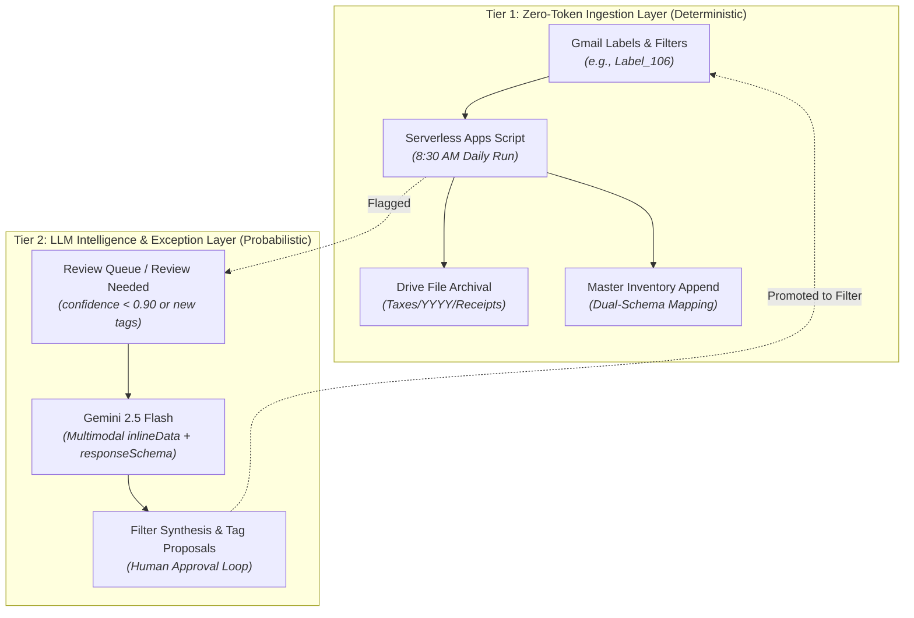

# Google Workspace Automation Architecture: Learnings, Patterns & Production Best Practices

**Location:** `gemini-spark/Automation_Architecture_Learnings_and_Best_Practices.md`
**Governing Directory:** [`gemini-spark`](https://drive.google.com/drive/folders/1XQyRsEx8gQl8idUv_UhfRMYxS9dIx0tk)
**Author:** Wryen Meek & Gemini (Antigravity)
**Date:** October 30, 2026
**Status:** Canonical Engineering Governance Standard

---

## 1. Executive Summary

This standard captures the architectural lessons, runtime failure modes, and foundational patterns developed during the end-to-end design, implementation, and remediation of the three primary Google Workspace automation pipelines in `gemini-spark`:
1. **Financial Receipts Ingestion:** Serverless Gmail label tracking, multi-year PDF archiving, and reconciliation ledger mapping.
2. **Writing Style & Tone Reference Index:** Incremental Drive scanning, AI-driven prose taxonomy classification, and Google Tasks notification loops.
3. **Drive Root Tagging:** Autonomous zero-token screening, multimodal PDF vision analysis, and human-in-the-loop review queues.
4. **Semantic Knowledge Graph Ingestion:** Serverless document & lore monitoring, multimodal PDF parsing, structured Gemini 2.5 Flash entity/relationship extraction into idempotent OpenCypher seeds (`MERGE` semantics), and offline ArcadeDB HybridRAG execution.

Future Google Workspace and AI agent automation systems implemented across this account must use the architectural baselines, coding patterns, and pre-flight validation standards defined in this document.

---

## 2. Core Architectural Patterns



### A. The Zero-Token / LLM Separation of Concerns (Hybrid Architecture)
* **The Principle:** Deterministic tasks must **never** consume LLM tokens. Moving files, extracting known regex strings, downloading attachments, mapping tabular columns, and reading Gmail metadata should execute on serverless infrastructure at zero marginal cost.
* **The Layering:**
  1. **Tier 1 (Deterministic / Zero-Token):** Google Apps Script runs daily on Google Cloud time triggers (e.g. 8:30 AM), handling 100% of the mechanical file archiving and row insertion.
  2. **Tier 2 (Probabilistic / LLM):** Gemini models (`gemini-2.5-flash`) are reserved exclusively for semantic ambiguity—extracting structured JSON from unformatted merchant emails, evaluating creative prose, classifying novel root files, and clustering taxonomy synonyms.
* **The Flywheel:** Every time the LLM resolves an ambiguous exception in Tier 2, the system synthesizes a deterministic filter (e.g., a high-precision Gmail query or title regex) so subsequent occurrences are automatically promoted to Tier 1 forever.

### B. Direct-to-Storage Metadata (Schema v1 JSONL in Drive Descriptions)
* **The Principle:** Avoid external databases for document metadata by utilizing Google Drive’s native 1,024-character `description` property on files.
* **The Format:** Store compact, versioned JSONL payloads directly on Drive files:
  ```json
  {"schema_v": 1, "doc_type": "Invoice", "tags": ["Tax / Financial Record", "Property / Home Record"], "confidence": 0.98, "tagged_by": "gemini_auto", "updated_at": "2026-10-30T22:16:37.941Z"}
  ```
* **Benefits:**
  - Persists across folder moves, renames, and sharing changes.
  - Enables zero-token pre-flight filtering: scripts skip already-classified files simply by querying for `description contains '"schema_v"'`.
  - Machine-readable by both Apps Script and external Python / CLI scripts.

### C. Self-Healing Review Queue Deduplication
* **The Trap:** When an automation flags an ambiguous file into a `Review_Queue` tab, the file remains in Drive without approval. On the next scheduled run, a naive scanner will re-examine the same folder and append duplicate rows to the review queue.
* **The Solution:**
  1. Implement a pre-scan memory index (`getQueuedFileIds(queueSheet)`) that reads all existing pending File IDs from `Review_Queue` before running the scanner.
  2. Skip any file already present in the queue.
  3. Enforce spreadsheet data validation dropdowns (`ONE_OF_LIST`: `Pending`, `Approved`, `Approved with Corrections`, `Rejected`) on the action column to provide a clean, human-in-the-loop audit interface.

### D. The Pre-Chunking Architecture (Overcoming the 15 MB V8 Heap Ceiling)
* **The Constraint:** Google Apps Script enforces a strict 15.0 MB V8 heap limit. Processing high-resolution sourcebooks (30 MB to 250 MB) in cloud script environments is impossible and results in immediate, fatal `Exceeded memory limit` crashes.
* **The Solution:** A dedicated offline Python pre-chunking companion tier (`scripts/fleet_prechunker.py`) that operates directly against Google Drive hierarchies:
  1. **Dual Slicing Hierarchy:** Extracts Level 1 and Level 2 Table of Contents (TOC) bookmarks into modular chapter sub-PDFs. For flat/unindexed PDFs, falls back to dynamic page-budgeting targeting ~8 MB per chunk.
  2. **Recursive Binary Bisection:** Any generated chapter exceeding 13.5 MB is automatically bisected into Part 1 and Part 2.
  3. **150 DPI Single-Page Raster Fallback:** Intercepts high-DPI uncompressed bitmap foldouts and maps (>13.5 MB single page) and re-encodes them via PyMuPDF image insertion at 150 DPI, compressing 22 MB foldouts down to 1.5–4.0 MB.
  4. **Dynamic Drive Hierarchy Routing:** Discovers or creates a dedicated `Extracted_Chapters` subfolder in each source folder and uploads the generated sub-PDFs with 1.2s courteous delay and exponential backoff retry for quota safety.

---

## 3. Google Workspace Runtime Traps & Concrete Fixes

| Trap / Anti-Pattern | Runtime Consequence | Correct Production Pattern |
| :--- | :--- | :--- |
| **`DriveApp.Folder.createFile` with `MimeType.GOOGLE_DOCS`** | Throws `Invalid argument: mimeType`. DriveApp cannot convert HTML/text into native Docs. | Use `DocumentApp.create(name)` + `body.setText(...)` + `docFile.moveTo(targetFolder)`. |
| **Drive API v3 Query Syntax in Apps Script (`modifiedTime`)** | Fails with invalid query parameter error at runtime. `DriveApp.searchFiles()` uses Drive API v2 syntax. | Use `modifiedDate > '...'` instead of `modifiedTime`. |
| **Direct String Deduplication on Sheet URLs** | Never matches existing files because the sheet stores full URLs (`https://docs.google.com/document/d/.../edit`), not plain IDs. | Always extract IDs with regex: `const id = (val.match(/[-\w]{25,}/) \|\| [])[0];` |
| **Raw Binary PDF String Extraction (`getDataAsString()`)** | Sends unparsed `%PDF-1.5...` byte streams to Gemini, exhausting context and failing inference. | Base64-encode the raw blob and pass via Gemini multimodal `inlineData` (`mimeType: 'application/pdf'`). |
| **Global Row Counting for Dynamic Exclusions** | Counting total rows in a rejection log (e.g. 800+ rows) causes the script to exclude *every* folder immediately. | Tag rejections with `[FolderID:<id>]` and count only matching markers per folder (`count >= 3`), guarding `root`. |
| **Single Ingestion Row Schema for Multi-Year Sheets** | Corrupts data by writing expense columns into reconciliation audit columns when sheets diverge. | Inspect the target sheet ID or column count dynamically to select the appropriate column mapping schema. |
| **Unbounded Loop Execution (`Timed out` after 360s)** | Time triggers running past Google's hard 6-minute execution cutoff are abruptly terminated by the platform. | Enforce `BATCH_SIZE` (5–10 items) and a 4-minute runtime budget (`Date.now() - startTime > 240,000`), exiting cleanly. |
| **Oversized PDF Heap Blowup (`Failed` / Out of Memory)** | Calling `getBlob().getBytes()` on 40–100 MB PDFs crashes the 128 MB Apps Script V8 heap and exceeds `UrlFetchApp` limits. | Enforce `file.getSize() < 14 MB` in Apps Script. Pre-process all oversized books with `scripts/fleet_prechunker.py`, which slices them into `< 13.5 MB` chapters with 150 DPI rasterization and uploads them to `Extracted_Chapters` subfolders for seamless ingestion. |
| **HTTP 429 Quota Exhaustion (`RESOURCE_EXHAUSTED`)** | Narrow model regexes or hardcoded ladders fail silently when deprecated models throw 404, artificially restricting failover to 1–2 models. | Implement **Dynamic Full-Fleet Discovery & Daily Quota State Tracking**: query `GET /v1beta/models`, filter out single-modality endpoints (`tts`, `image`, `lyria`), prioritize high-throughput Flash tiers (`2.5-flash`, `2.5-flash-lite`, `flash-latest`, `3.5-flash`, `3.1-flash-lite`, etc.) followed by Pro tiers (`2.5-pro`, `pro-latest`, `gemini-4-argon`), ban daily-exhausted models (RPD) until UTC midnight via `CacheService` + `ScriptProperties`, and rotate across 18+ independent quota buckets. |
| **Flat Folder Enumeration (`Folder.getFiles()`)** | Fails to discover documents nested in subdirectories (e.g., issue folders, playtest packets, media archives). | Implement **Recursive Breadth-First Traversal (BFS)** with a visited folder ID `Set`, discovering child folders via `Folder.getFolders()` while strictly enforcing batch limits and execution time budgets across iterations. |

---

## 4. Production Engineering & Deployment Baseline

Every production Google Workspace automation must adhere to the following delivery baseline:

### 1. The Documentation Triad
Never deploy code in isolation. Every production automation in `gemini-spark` must maintain three co-located artifacts:
1. **Technical Specification & Code (`<Name>_Automation_Code.gs.md`):** Complete system architecture, schema definitions, and production `Code.gs` source.
2. **Operational Companion SOP / QA Rubric (`<Name>_Procedure.md` or `QA_Procedures.md`):** Explicit qualification/disqualification rules, error-handling protocols, and human review steps.
3. **Live Container-Bound Project:** Linked directly to the Master Google Spreadsheet via `@google/clasp`.

### 2. Pre-Flight Offline Unit Testing
Do not rely on clicking **Run** in the Apps Script browser editor for rapid development.
* Use a local test runner (e.g., Bun or Node) with an isolated `vm` context to mock Workspace interfaces (`SpreadsheetApp`, `DriveApp`, `GmailApp`).
* Run automated regression suites (like [`test/apps_script.test.ts`](file:///Users/wryen/.gemini/antigravity/scratch/gemini-spark-automations/test/apps_script.test.ts)) to verify:
  - Regex extractions (URLs, order numbers, amounts).
  - Date normalization (handling float years like `2020.0` and Excel serial numbers like `46241.0`).
  - Column schema mappings across different sheet years.
  - Infinite queueing deduplication guards.

### 3. Container-Bound Architecture & Secrets Isolation
* **Container-Bound Scripts:** Always bind the Apps Script project to its master spreadsheet (`clasp create --parentId <SHEET_ID>`). This enables UI menu triggers (`onOpen`), simplifies permission models, and ensures the code travels with the sheet.
* **Secrets in Script Properties:** Never commit API keys or personal credentials into `Code.gs`. Access secrets via:
  ```javascript
  const apiKey = PropertiesService.getScriptProperties().getProperty('GEMINI_API_KEY');
  ```

### 4. Scheduled Ingestion & LLM Scan Handshake
When coordinating serverless Workspace scripts with scheduled LLM agents (e.g., Gemini Scheduled Prompts or sidecars):
* **Phase Ingestion Ahead of Auditing:** Schedule deterministic ingestion to complete **30 to 60 minutes prior** to the scheduled LLM scan (e.g., Apps Script runs at 8:30 AM; Gemini scan runs at 9:00 AM).
* **Scope LLM Prompts to Exceptions Only:** The scheduled LLM prompt should never re-parse raw emails or write full spreadsheets. Its prompt must be strictly scoped to:
  1. Inspecting threads labeled `receipts/review_needed`.
  2. Auditing spreadsheet rows marked `Unreconciled (Auto-Ingested)` or `Pending Reconciliation`.
  3. Synthesizing new deterministic filter queries to expand the zero-token ingestion pipeline.

---

## 5. Active Pipeline Reference Matrix

| System Pipeline | Bound Script Name | Master Asset / Google Sheet | Technical Spec | Companion SOP / QA |
| :--- | :--- | :--- | :--- | :--- |
| **Financial Receipts Ingestion** | [`Financial-Receipts-Ingestion`](https://script.google.com/d/1PzJn5MJCCE4K0UhZHqS9rboJUpjR7P5psLi1DjQxPpHmKKPAIuxQdkfJ/edit) | [2026 Inventory](https://docs.google.com/spreadsheets/d/194nQzKDYo0Bt8tfO1P1UBAD-dtDgSb7CWDatv61-ADI/edit)<br>[2025 Inventory](https://docs.google.com/spreadsheets/d/1BzwXcQpvlSJ1ccdmfOQ8COZ2EIBSDOQ0UP7he73Yj-Q/edit) | [`Receipts_Ingestion_Automation_Code.gs.md`](https://docs.google.com/document/d/1ezcHQvkzr4sM-uLSWiQToKgvWaozWohLrstsAe6UA7g/edit) | [`Financial_Receipts_Label_Refinement_Procedure`](https://docs.google.com/document/d/1TNP58lmMvvi3BHIPTgfVMlm14gPK34QCxWTE5jmlBmk/edit) |
| **Writing Style & Tone Index** | [`Writing-Style-Index-Automation`](https://script.google.com/d/1yuepYNbNxeZmYvy7LfmNeN6k1XgKgn-jWNA3nNkHlWgAXdEPfbIzDIwu/edit) | [Writing Style & Tone Reference Index](https://docs.google.com/spreadsheets/d/1HPY3pKrgzeJr1FMLiK_UNyNJcfPTanJoPRL3ikF_nA8/edit) | [`Writing_Style_Index_Automation_Code.gs.md`](https://docs.google.com/document/d/1vLxrT-IdxoSXEYNRTHK05DobNn6ZStVdrERm8gIFu7Q/edit) | In-Sheet `Rules & Guidelines` & `Maintenance & Workflow` |
| **Drive Root Tagging** | [`Drive-Tagging-Automation`](https://script.google.com/d/1F2-pZJZ1jzfoNS7EgnQOYXOwii5YEU7rFOMKOWN52k2GQcWrBpPbp2-w/edit) | [Drive Tagging Master Index](https://docs.google.com/spreadsheets/d/1XE78-Gae0a5DfkuC0lJcy62XjreqPIPovy8LuoAT3gA/edit) | [`Drive_Tagging_Automation_Code.gs.md`](https://docs.google.com/document/d/1VZj8q42K6X6TEOqvwRdNb-rS2TnHTAMf1jKZazOZeoU/edit) | [`Drive_Tagging_QA_Procedures.md`](https://docs.google.com/document/d/1sUoDzsLKt1JyLpruwnReAHhAqvuraE_UMOzRKTr1BL4/edit) |
| **Semantic Knowledge Graph Ingestion** | [`MCDM-Archive-Knowledge-Graph-Ingestion`](https://script.google.com/d/1WLRQ7rZnz-LmtKmssiCyjrm8vL2ikG-KdPjTfiSI28TuB6F2XdP21kFZ/edit) | [MCDM_Archive_Knowledge_Graph](https://drive.google.com/drive/folders/1YECmZ3sMeAttBS2OTR_8WJaa_Bt5mO4b)<br>[assets/seeds](https://drive.google.com/drive/folders/1v9uyJ_rnGGUsuytisYKH6YcM1nF60dkT) | [`Knowledge_Graph_Automation_Code.gs.md`](https://drive.google.com/file/d/1GXWpPDTaoj5MyWjZjstAhsMBU8JgmEmt/view) | [`Knowledge_Graph_QA_Procedures.md`](https://drive.google.com/file/d/10lj16vFN6ryN0UUDe62H0AgCXgbYCp6G/view) |
| **Universal Entity & Schema Extraction** | Universal Extraction Library | [`Skill Resources`](https://drive.google.com/drive/folders/1qrsATL6edhrjs3HsY_R73ekoJdBm3nNP)<br>`/Users/wryen/Documents/Gemini/entity-extraction-automation` | [`Entity_Extraction_Automation_Code.gs.md`](https://docs.google.com/document/d/1MyP4sjx1BXIwjiKq-3sG0k-ozX7c3vWdhlPQa68mpTw/edit) | [`Entity_Extraction_QA_Procedures.md`](https://docs.google.com/document/d/1xqckd5v2yOPkGnTkXrzZsUYHuUCnFzdAHnsq5dYdhFQ/edit) |
| **Shared Architectural Rubric** | N/A | Local Sandbox & Cloud Workspace | [`Automation Decision Rubric.md`](https://docs.google.com/document/d/1XtL0AET8xsvXR0KHHGgRoo3-fucssnRabV35qUYp1xY/edit) | [`Folder_Creation_vs_Reuse_Guidelines.md`](https://docs.google.com/document/d/1yACv59zijgBy2naWMZREyBfyJqNRMXNxyzrJYfjmnks/edit) |
