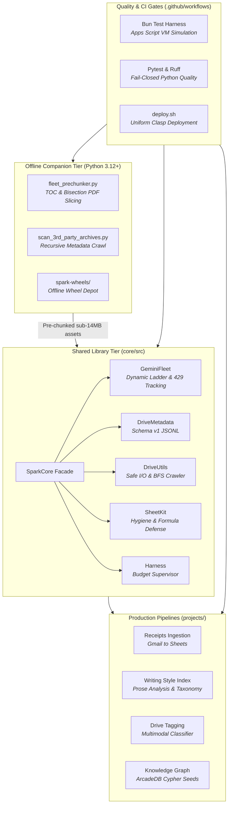
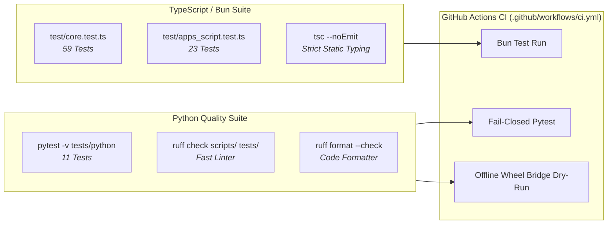

# Gemini Spark Automations — Architecture & Implementation Plan

**Repository:** [`wryenmeek/gemini-spark-automations`](https://github.com/wryenmeek/gemini-spark-automations)
**Status:** **Implemented, Verified & Deployed**
**Author:** Wryen Meek & Gemini (Antigravity)
**Target Environments:** Google Apps Script (V8 runtime), Node.js / Bun (CI & Unit Testing), Python 3.12+ (Offline Processing & Wheel Bridge)

---

## 1. Executive Summary & Purpose

The `gemini-spark-automations` repository centralizes the architecture, shared infrastructure, and deployment automation for the Google Workspace pipelines powering the `gemini-spark` ecosystem.

Historically, automations were created as container-bound Google Apps Scripts attached to individual Google Sheets, accompanied by Google Docs in Google Drive representing system code and operational SOPs. While functional, this introduced three critical maintenance bottlenecks:
1. **Redundant Infrastructure:** Duplicate model rotation, quota handling, regex parsing, and Drive crawler code copied across every project.
2. **Missing Local Verification:** Inability to run automated CI/CD unit tests, linting, or type checking before pushing code live via clasp.
3. **Execution Boundary Limits:** Large asset workflows (such as multi-megabyte PDFs and binary archives) frequently exceeded Apps Script's 6-minute execution window and 15 MB payload limits without an offline companion processing tier.

This implementation plan establishes a unified, dual-runtime architecture:
- **`core/` (SparkCore):** A reusable standalone Google Apps Script library and CommonJS module providing robust shared services (model fleet routing, zero-token Drive metadata, safe document handling, sheet hygiene, and execution supervisors).
- **`projects/`:** Clean container-bound implementations linking directly to production Google Sheets via `@google/clasp`.
- **`scripts/` & `spark-wheels/`:** An offline Python tier handling high-throughput Drive crawling, PDF pre-chunking, and offline dependency distribution.
- **`test/` & `tests/`:** Dual-language automated verification suites running in GitHub Actions CI with fail-closed quality gates.

---

## 2. System Architecture



---

## 3. Core Library Subsystem Requirements & Design

All shared infrastructure resides in [`core/src/`](file:///Users/wryen/.gemini/antigravity/scratch/gemini-spark-automations/core/src) and must satisfy dual-runtime compatibility (Apps Script V8 global scope and Bun/Node CommonJS module loading).

### 3.1 SparkCore Facade & Module Resolution (`SparkCore.js`)
- **Universal Export:** Subsystems must resolve cleanly in both browser/Apps Script global scope and CommonJS (`require("./src/...")`) environments without throwing `ReferenceError`.
- **Lazy Getter Resolution:** Subsystems (`GeminiFleet`, `DriveMetadata`, `DriveUtils`, `SheetKit`, `Harness`) must be bound through dynamic getter properties on `SparkCore` so that load order differences in Apps Script or test harnesses do not cause undefined references.
- **Convenience Delegation:** Direct facade methods must validate subsystem availability and throw actionable diagnostic errors if an underlying module is missing.

### 3.2 Dynamic Gemini Model Fleet (`GeminiFleet.js`)
- **Flash-First Prioritization:** Model ranking must prioritize fast, cost-effective Flash models (`gemini-2.5-flash`, `gemini-2.5-flash-lite`, `gemini-3.5-flash`) before escalating to heavy reasoning tiers (`gemini-2.5-pro`, `gemini-4-argon`).
- **Dynamic Model Discovery:** Actively query `GET /v1beta/models`, filtering out non-generative or specialized endpoints (`tts`, `image`, `lyria`, `transcribe`, `computer-use`, `embed`).
- **Canonical Model Naming:** Automatically strip any leading `models/` prefix from requested model strings to ensure URLs never construct invalid paths like `models/models/...`.
- **Quota Separation (RPM vs. RPD):**
  - Transient HTTP 429 / 503 limits must trigger exponential backoff pauses (default: 1,500ms) and inline retries.
  - Hard daily exhaustion (Resource Exhausted / RPD) must ban the model across `CacheService` and `ScriptProperties` until UTC midnight, rotating immediately to the next ladder tier.
- **Deterministic Fast-Exit on Safety Filtering:** If a response candidate contains a `finishReason` of `SAFETY`, `RECITATION`, or `BLOCKLIST`, or if `promptFeedback.blockReason` is present, execution must exit immediately with `{ error: "BLOCKED_BY_SAFETY" }` rather than wasting API quota rotating through remaining models.
- **Execution Budget Checks:** Model ladder iteration must accept an optional `isTimeExpiring()` callback, halting rotation before exceeding script runtime thresholds.
- **Conversational Code Block Extraction:** Extract structured JSON from responses using robust regex patterns (`/```(?:json)?\s*([\s\S]*?)\s*```/`) to tolerate conversational preambles or postscripts generated by LLMs.
- **Single Source of Model Priority:** Model priority rankings must be derived dynamically from the position in `DEFAULT_MODEL_LADDER` rather than maintaining duplicate lookup tables.

### 3.3 Zero-Token Storage Metadata (`DriveMetadata.js`)
- **Schema v1 JSONL Specification:** Machine-readable JSONL formatted metadata stored directly in the Google Drive file `description` property (max 1,024 characters).
- **Strict Schema Enforcement:** `parseMetadata` must require `schema_v === 1` to prevent false positive classification from unstructured user descriptions or arbitrary JSON.
- **Zero-Token Pre-Flight Screening:** Scheduled crawlers can identify pre-processed files with zero LLM API spend by verifying `description.includes('"schema_v"')`.
- **Progressive Tag Trimming:** If the serialized metadata payload exceeds 1,024 bytes, tags must be progressively trimmed down to zero tags if necessary to satisfy Drive API limits before failing.

### 3.4 Safe Drive I/O & Bounded Extraction (`DriveUtils.js`)
- **MIME Type Trap Prevention:** Never invoke `DriveApp.Folder.createFile` with `MimeType.GOOGLE_DOCS` (which throws a runtime exception in Apps Script). Use `DocumentApp.create()` followed by `file.moveTo(targetFolder)`.
- **Heap OOM Defense:** When extracting text snippets from multi-megabyte documents, pre-slice a character sampling window (`Math.max(1000, wordLimit * 30)`) before executing regex whitespace splitting, preventing Apps Script V8 heap exhaustion.
- **25+ Character ID Extraction:** Use regex pattern `/([-\w]{25,})/` to reliably parse pure Google Drive File IDs from arbitrary URLs, sharing links, or raw ID strings.
- **Bounded BFS Tree Crawling:** Implement recursive folder discovery with depth bounding, visited ID tracking, and execution time budget checks to guard against cyclic folder links.

### 3.5 Spreadsheet Hygiene & Injection Defense (`SheetKit.js`)
- **Queue Deduplication:** Extract pending IDs from sheets before queuing to prevent unbounded duplicate queue growth.
- **Data Normalizers:**
  - Standardize float years (`2025.0` -> `"2025"`).
  - Convert Excel serial date numbers (`46241.0` -> `"2026-08-07"`).
  - Parse ISO date strings (`"2025-08-15"` -> `"2025"` or `"2025-08-15"`).
- **Dynamic Grid Expansion:** Automatically expand both rows (`insertRowsAfter`) and columns (`insertColumnsAfter`) when appending data that exceeds existing spreadsheet boundaries.
- **Formula Injection (CSV Injection) Sanitization:** Sanitize all string cell values by prefixing dangerous characters (`=`, `+`, `-`, `@`, `\t`, `\r`) with a single quote (`'`), ensuring untrusted file titles or LLM output cannot execute malicious spreadsheet formulas.

### 3.6 Execution Supervisor (`Harness.js`)
- **Runtime Budget Supervisor:** Monitor execution time against Google's hard 6-minute cutoff (default budget: 240,000ms), allowing loops to exit cleanly, persist state checkpoints, and reschedule without script crashes.
- **Safe Execution & Alerting:** Standardize `safeExecute` wrappers and formatted email alert dispatching for fatal pipeline failures.

---

## 4. Offline Processing & Tooling Requirements (`scripts/`)

To support documents exceeding Google Apps Script limits (such as 100MB+ rulebooks and high-resolution PDFs), offline Python tools complement the cloud pipelines.

### 4.1 Fleet Pre-Chunker (`fleet_prechunker.py`)
- **Smart TOC & Recursive Bisection:** Slices PDFs using Level 1/2 Table of Contents bookmarks. Slices exceeding 13.5 MB are recursively bisected; single pages exceeding limits are re-rasterized at 150 DPI.
- **Subprocess Safety & Timeouts:** All external CLI calls (`gdrive readonly`, `gdrive mutate`) must specify explicit timeouts (minimum 15s; 60s for metadata/mkdir, 300s for file upload/download) and handle `subprocess.TimeoutExpired`.
- **4-Token Output Parsing:** Parser must robustly extract filenames on variable-token CLI output, correctly distinguishing folder lines from multi-word filenames.
- **Path Traversal Protection:** Sanitize downloaded filenames via `os.path.basename` and enforce that file destination paths resolve strictly within the designated temporary workspace directory.
- **Fail-Closed Folder Creation:** If remote directory creation fails, return `None` and abort rather than dumping sliced chunks into parent or publisher root folders.
- **Atomic Upload Verification:** Only mark a document as `completed` in persistent state if 100% of chunks are verified in Google Drive; partial uploads must be recorded as `partial_failure`.
- **Resource Cleanup:** All PyMuPDF document instances (`chunk_doc`, `opt_doc`, `doc`) must be closed in `finally` blocks to prevent descriptor leaks.
- **Portability:** Use `os.path.expanduser("~/Downloads")` instead of hardcoded user directories, and make binary dependencies optional at import time.

### 4.2 3rd Party Archive Scanner (`scan_3rd_party_archives.py`)
- **Recursive BFS Crawler:** Discovers publisher archives, categorizes regular vs. oversized PDFs, and persists `parent_id` and `parent_path` metadata for automated pipeline targeting.

---

## 5. Deployment & Security Standards

### 5.1 Multi-Project Clasp Deployment (`deploy.sh`)
- **Uniform Project Structure:** All production pipelines (`projects/receipts-ingestion`, `projects/writing-style-index`, `projects/drive-tagging`, `projects/knowledge-graph-ingestion`) and the standalone library (`core/`) must deploy via standardized `deploy_bound_project` and `deploy_standalone_library` functions.
- **Idempotent Push:** Verify `.clasp.json` configuration and execute clasp push with clear error reporting.

### 5.2 Least-Privilege OAuth Scopes (`appsscript.json`)
- Standalone libraries and pipelines must request only required functional scopes (`drive`, `documents`, `spreadsheets`, `script.external_request`, `script.send_mail`).
- Overprivileged scopes (such as `userinfo.email` and `script.storage`) are pruned unless explicitly required by user identity flows.

---

## 6. Verification & Quality Assurance Architecture



### 6.1 Test Suite Breakdown
1. **SparkCore Test Suite ([`test/core.test.ts`](file:///Users/wryen/.gemini/antigravity/scratch/gemini-spark-automations/test/core.test.ts)):**
   - 59 comprehensive unit tests verifying CommonJS/TS module resolution, safety filter fast-exit, heap OOM sampling, quota tracking, formula injection escaping, column expansion, and tag trimming.
2. **Production Pipeline Regression Suite ([`test/apps_script.test.ts`](file:///Users/wryen/.gemini/antigravity/scratch/gemini-spark-automations/test/apps_script.test.ts)):**
   - 23 end-to-end simulated tests for receipt extraction, writing style delta indexing, drive tagging vision payloads, and knowledge graph Cypher generation.
3. **Python Regression Suite ([`tests/python/`](file:///Users/wryen/.gemini/antigravity/scratch/gemini-spark-automations/tests/python)):**
   - 11 unit tests covering 4-token CLI parsing, subprocess timeout handling, partial upload failure marking, path traversal sanitization, and fail-closed folder creation.

### 6.2 CI Fail-Closed Guarantees
- Continuous integration in [`.github/workflows/ci.yml`](file:///Users/wryen/.gemini/antigravity/scratch/gemini-spark-automations/.github/workflows/ci.yml) runs Python tests directly via `pytest -v tests/python` without skip conditions, ensuring tests cannot be silently bypassed.
- Strict static type checking via `tsc --noEmit` ensures all subsystem facade types match across implementations.
